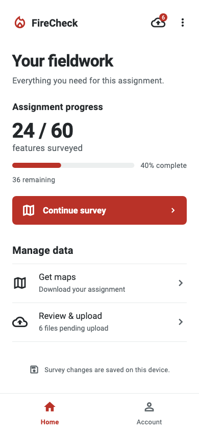
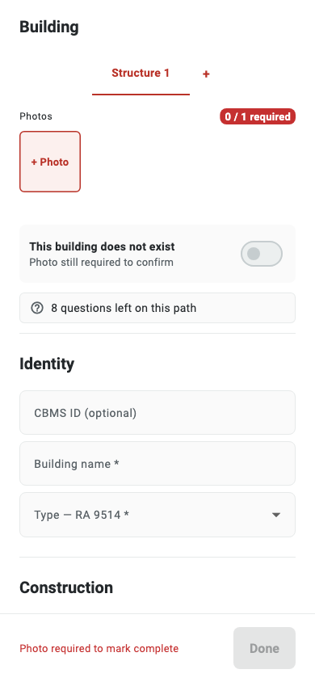
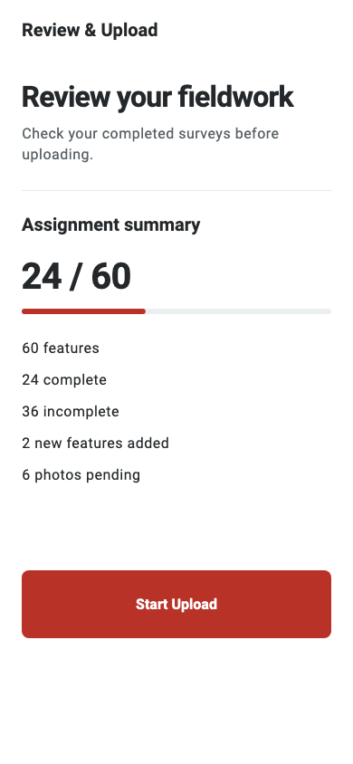

# FireCheck Mobile

FireCheck Mobile is an Android field survey app for enumerators working on Philippine Bureau of Fire Protection (BFP) assessments. Enumerators download an assigned map, collect building, road, and household survey data offline, then review and upload it when they reconnect.

**MVP for academic evaluation · Android 0.1.3**

## Features

| Feature | What it supports |
| --- | --- |
| Offline fieldwork | Download assignment data and map tiles, then use the map and save survey edits without connectivity. |
| Building and road surveys | Capture building construction and fire load details, road width and surface material, and photos. Add a building or road missing from the map. |
| Household fire vulnerability | Complete the Oplan Ligtas na Pamayanan (OLP) household survey and view its *Lebel ng Kahinaan* score. |
| Review and upload | Review edited and newly added features before submitting. Track the upload and retry failed transfers. |

## Screenshots

Flutter test captures using sample data.

| Home | Building survey | Upload review |
| --- | --- | --- |
|  |  |  |

## Install the demo APK

[Download the signed FireCheck 0.1.3 demo APK (ARM64)](https://github.com/jlescarlan11/firecheck/releases/download/v0.1.3/FireCheck-0.1.3-arm64-v8a.apk).

Download the APK on an ARM64 phone running Android 8.0 or later and open it to install. If Android prompts you, allow installation from the app you used to open the APK.

The project team needs to enroll your Google sign-in account in a published sample assignment before you can download the demo map. [Android release guide](docs/ANDROID_RELEASE.md)

## Try the app

1. While online, sign in, select **Get Maps**, download the assigned map, and select **Open map**.
2. Turn off network access, select a building polygon, fill out the survey, add a photo, and save. Reopen the survey to confirm the data persisted.
3. Reconnect, choose **Upload Data**, review the edited or newly added features, and select **Start Upload**. Check the upload progress and confirm that the submission completes.

## Run from source

Install Flutter and the Android SDK. The evaluation checks used Flutter 3.41.9 and Dart 3.11.5.

1. Clone the repository and open its root in Android Studio with the Flutter plugin installed.

   ```bash
   git clone https://github.com/jlescarlan11/firecheck.git
   cd firecheck
   cp .env.example .env
   flutter pub get
   flutter gen-l10n
   ```

2. Set your Supabase URL and publishable key, public Mapbox token, Google web OAuth client ID, and gateway URL in `.env`. Place the matching Firebase Android configuration at `android/app/google-services.json` and register the SHA-1 of the signing key used for the build. The app bundles `.env`, so use public client configuration there. [Independent setup guide](docs/SELF_HOSTED_SETUP.md)
3. Start an Android emulator or connect a phone with USB debugging enabled. Run `lib/main.dart` from Android Studio or use `flutter run` in the project root.

## Set up Google Drive for a demo

The evaluation APK uses the original project's hosted gateway. For that demo, ask the project team to enroll your Google sign-in account in a published sample assignment. To use Drive folders and accounts you control, deploy your own gateway and build the Android app with your project settings. [Independent setup guide](docs/SELF_HOSTED_SETUP.md)

### Folder and file layout

A supervisor can create this structure under a shared folder in the owner's My Drive:

```text
firecheck/
├── input/
│   └── demo-area/
│       ├── boundary.shp, boundary.shx, boundary.dbf, boundary.prj
│       ├── buildings.shp, buildings.shx, buildings.dbf, buildings.prj
│       └── roads.shp, roads.shx, roads.dbf, roads.prj
├── published/
└── output/
```

- Place the actual files directly in the assignment folder. Each row above lists four separate files with the same base name. Use the lowercase names shown for a standard demo.
- Use an area polygon for `boundary`, building polygons for `buildings`, and road lines for `roads`. Export the demo layers in WGS 84 / UTM zone 51N (EPSG:32651). For the standard survey schema, include `feat_id`, `bldg_use`, and `bldg_type` in the building attributes, and `feat_id` and `road_type` in the road attributes.
- If the demo uses a custom survey, place `form_definition.json` and/or `field_requirements.txt` alongside the shapefile components. The app has bundled defaults for a demo that uses the standard survey.
- The gateway copies input files to `published/` when the supervisor publishes an assignment. Update the files under `input/` and publish again to release a new version. The gateway creates upload folders under `output/` as surveys are submitted.

### Connect, publish, and enroll

For a new deployment, configure the gateway with the three Drive folder IDs and authorize the designated Drive owner's account using server-side OAuth. Follow the gateway guide for database setup, owner authorization, and deployment. [Drive gateway setup](server/drive-gateway/README.md)

From `server/drive-gateway/`, use the supervisor CLI to register the exact Drive ID of `demo-area/`, publish the map, and grant the evaluator access. This requires a Supabase assignment record and the evaluator's Supabase user UUID. If you need to create the assignment, the CLI's `create` command accepts a JSON file with `id`, `name`, `campaignId`, and a WGS 84 GeoJSON Polygon in `boundary`. Use the configured gateway URL and the supervisor's FireCheck session token in the CLI environment.

```bash
npm run admin -- source ASSIGNMENT_UUID DRIVE_INPUT_SUBFOLDER_ID
npm run admin -- publish ASSIGNMENT_UUID
npm run admin -- enroll ASSIGNMENT_UUID EVALUATOR_USER_UUID
```

The evaluator can then sign in and open **Get Maps**. If the map is missing, check that the supervisor published a version and enrolled the same account the evaluator used to sign in.

## Tech stack

- Dart and Flutter for the Android app, with Riverpod for state management.
- Drift and SQLite for offline data and the upload queue.
- Mapbox Maps SDK for maps and offline tiles.
- Supabase Auth, Postgres/PostGIS, and Storage for sign-in, survey records, and photos.
- A Supabase Edge Function gateway for downloading maps from and uploading shapefile exports to Google Drive.

## Validation

| Check | Result for source revision `94b6713` |
| --- | --- |
| `flutter test` | 920 passed, 2 skipped |
| `flutter analyze` | 0 errors, 16 warnings, and 637 informational diagnostics |
| Android APK | Verified the ARM64 APK signature and confirmed package `ph.gov.bfp.firecheck`, version 0.1.3 |
| Live Android walkthrough | Sign-in, map download, and upload still need to be verified together on a device |

## Architecture and documentation

- [`lib/features`](lib/features/) contains the assignment, map, survey, review, and upload screens and workflows.
- [`lib/core`](lib/core/) handles shared services. Drift and SQLite store work locally, Mapbox renders maps, and a local upload queue tracks work until it can be sent.
- [`supabase`](supabase/) contains the backend schema and migrations for Supabase and PostGIS. The [Drive gateway](server/drive-gateway/) handles hosted Google Drive operations.
- [`test`](test/) contains Flutter unit and widget tests. The [design specification](docs/superpowers/specs/2026-04-24-firecheck-mobile-design.md) explains the original architecture and sync model.

FireCheck Mobile is available under the [MIT License](LICENSE).
